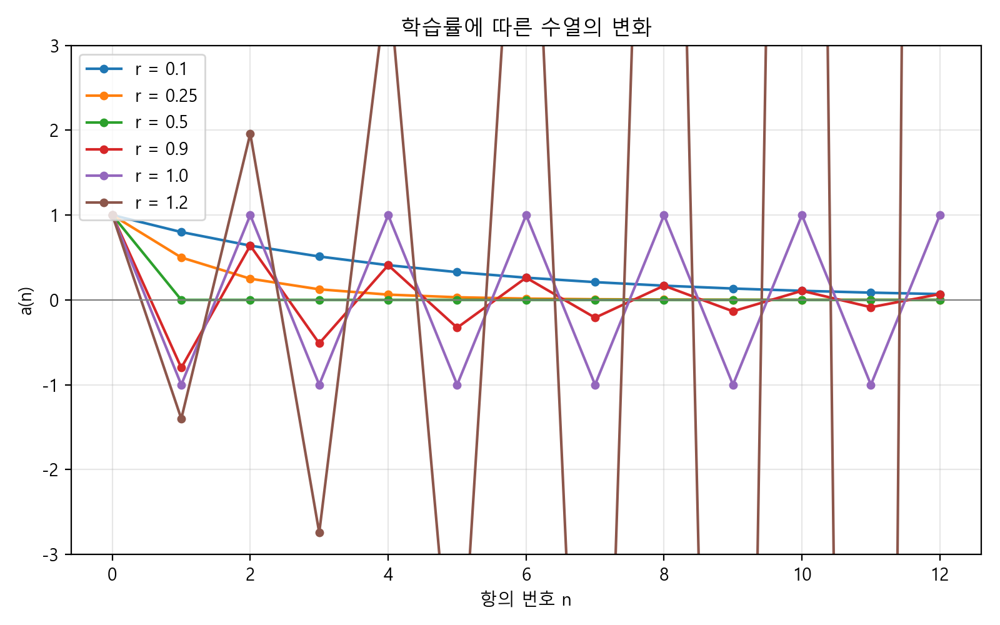
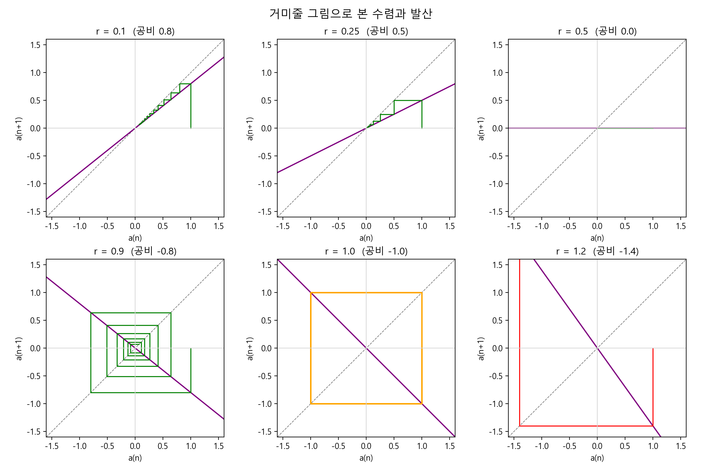
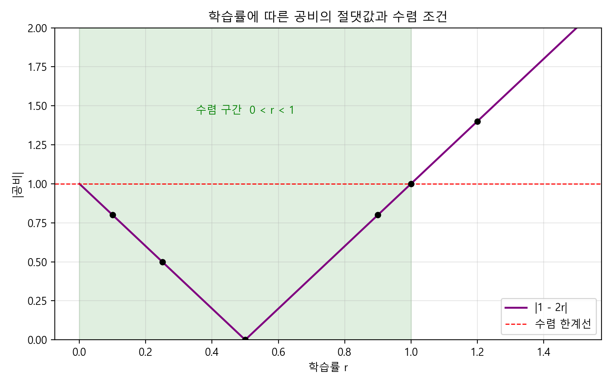
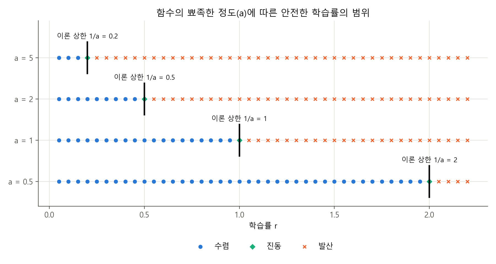
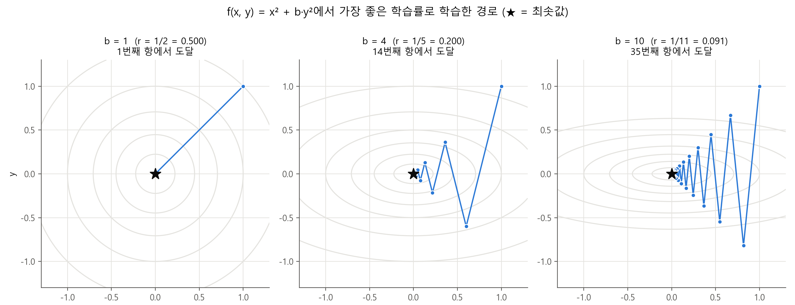
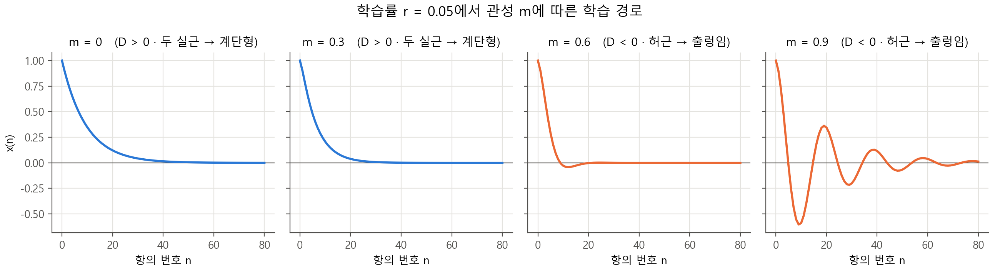
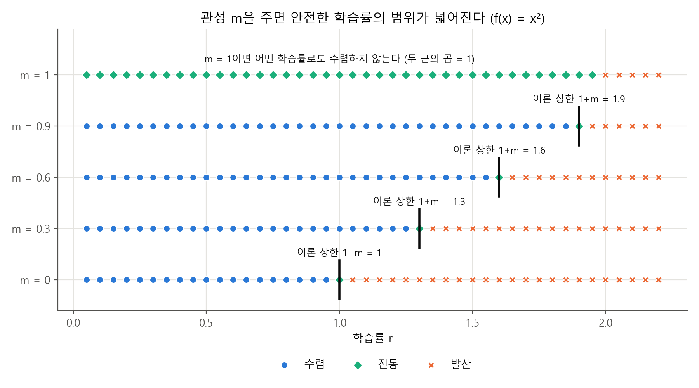
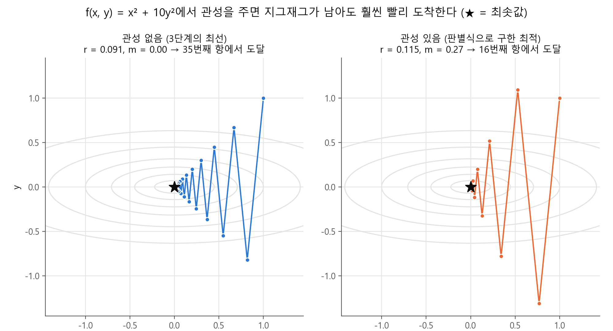
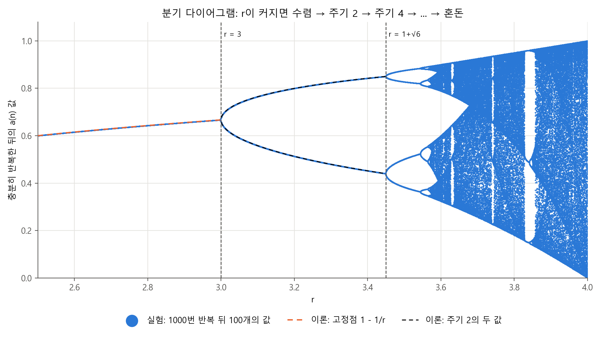

<!--
  보고서 초안 (2026-09-30)
  - 학번·이름 반영 완료. 참고문헌은 docs/선행연구_자료.md에서 확인한 자료다.
  - 그림은 figures/ 폴더의 원본 파일을 연결해 두었다. 보고서용 번호는 docs/보고서_작성준비.md 3장과 같다.
  - 숫자는 모두 results/ 폴더의 CSV 값에서 가져왔다.
-->

<b>'점화식과 등비수열의 수렴 조건을 이용한 인공지능 학습률 분석'</b>

 
 

---

## Ⅰ. 서론

### 1. 탐구 동기(주제선정 이유)

수학 시간에 수열 단원을 공부하면서 점화식에 흥미를 느꼈다. 앞의 항으로 다음 항을 만들어 간다는 규칙이 인상적이었는데, 식으로만 보아서는 그 수열이 실제로 어떤 모양으로 움직이는지 잘 와닿지 않았다. 그래서 수열의 각 항을 좌표평면에 직접 나타내어 눈으로 확인해 보고 싶다는 생각이 들었다.

수열을 그래프로 표현하는 방법을 조사하던 중, 같은 형태의 점화식이라도 값에 따라 어떤 수열은 한 점으로 모여들고 어떤 수열은 끝없이 커진다는 것을 알게 되었다. 그런데 이 과정에서 인공지능이 학습하는 규칙 또한 앞의 값에 일정한 양을 더하거나 빼서 다음 값을 정하는, 즉 점화식과 같은 구조를 가진다는 사실을 발견하였다. 인공지능이 스스로 답을 찾아간다는 표현이 사실은 하나의 수열이 특정한 값으로 다가가는 과정이라는 점이 놀라웠다.

여기서 자연스럽게 하나의 질문이 생겼다. 수열이 수렴하기도 하고 발산하기도 한다면, 인공지능 역시 학습에 성공할 때와 실패할 때가 있는 것이 아닐까. 그리고 그 성패를 가르는 조건을 수열의 수렴 조건으로 설명할 수 있지 않을까. 평소 컴퓨터로 직접 시뮬레이션하여 결과를 눈으로 확인하는 것을 좋아했기에, 이 질문을 실제로 계산하고 그래프로 그려 검증해 보고자 본 주제를 선정하였다.

### 2. 탐구 목적과 필요성

본 탐구의 목적은 인공지능의 학습 과정을 점화식으로 나타내고, 그 수열이 수렴하기 위한 조건을 구하여 인공지능이 안정적으로 학습할 수 있는 학습률의 범위를 밝히는 데 있다. 이를 위해 가장 단순한 이차함수 $f(x) = x^2$에서 출발하여 학습 과정을 등비수열로 표현하고, 이론적으로 유도한 수렴 조건이 실제 시뮬레이션 결과와 일치하는지 확인하였다. 나아가 함수의 모양이 달라질 때, 변수가 두 개일 때, 학습 규칙에 관성(모멘텀)을 더했을 때 그 조건이 어떻게 달라지는지도 같은 방법으로 알아보고자 하였다.

학습률은 인공지능의 성능을 좌우하는 중요한 값이지만, 입문 자료에서는 흔히 "너무 크지도 너무 작지도 않게 골라야 하는 값"으로만 소개되고, 그 범위를 식으로 제시하지는 않는다(Google for Developers, 2025). 그러나 이 기준은 수열의 수렴 조건이라는 수학적 근거로 설명될 수 있으며, 이는 고등학교 과정에서 배우는 판별식, 등비수열, 근과 계수의 관계만으로도 유도할 수 있다. 인공지능을 결과만 활용하는 도구가 아니라 그 작동 원리를 수학으로 이해하는 대상으로 다루어 본다는 점에서 본 탐구의 필요성이 있다.

---

## Ⅱ. 이론적 배경

### 1. 선행연구 분석

인공지능은 예측이 틀린 정도를 나타내는 함수(손실함수)의 값이 가장 작아지는 지점을 찾는 방식으로 학습하며, 이때 기본적으로 쓰이는 방법이 경사하강법이다. 경사하강법은 기울기에 학습률을 곱한 만큼 이동하여 다음 값을 정하는데, 학습률이 너무 작으면 수렴하는 데 반복이 너무 많이 필요하고, 너무 크면 손실이 튀거나 계속 증가하여 수렴하지 않는다(Google for Developers, 2025). 다만 이 자료는 학습률을 "너무 높지도 너무 낮지도 않게" 고르라고 설명할 뿐, 그 범위를 식으로 제시하지는 않는다.

우리나라 고등학교에도 경사하강법을 다루는 〈인공지능 수학〉 과목이 있으며, 구나영과 최인용(2022)은 이 과목의 교과서 5종이 예측과 최적화를 다루는 방식을 분석하여 교과서마다 차이가 있음을 밝혔다.

관성(모멘텀)을 더한 경사하강법에 대해서는 Goh(2017)가 이차함수를 대상으로 학습률과 관성의 수렴 조건, 가장 빠른 학습률과 관성의 값을 대학 수준의 수학으로 제시하였다. 본 탐구의 결과를 이 글의 기호로 바꾸어 비교하면, 관성이 있을 때의 학습률 범위 $0 < r < \frac{1+m}{a}$, 가장 빠른 관성 $\sqrt{m} = \frac{\sqrt{b} - \sqrt{a}}{\sqrt{b} + \sqrt{a}}$, 출렁임이 생기는 조건이 판별식이 음수일 때라는 점 등이 모두 일치한다.

따라서 본 탐구의 결과는 이미 알려진 사실이다. 그러나 기존 자료가 미분이나 대학 수준의 수학을 이용하는 것과 달리, 본 탐구는 **접선의 판별식, 등비수열의 수렴 조건, 근과 계수의 관계만으로 같은 결론을 유도하고 이를 시뮬레이션으로 검증하였다**는 점에서 의의가 있다. 또한 이론으로 구한 최적 조건에서 실제 도달 횟수가 오히려 많았던 경우를 발견하고 그 원인을 설명하였다.

### 2. 이론적 배경

**(1) 등비수열의 수렴 조건**

첫째항이 $a_0$, 공비가 $k$인 등비수열 $a_n = a_0 \cdot k^n$은 $|k| < 1$이면 0으로 수렴하고, $k = -1$이면 두 값을 번갈아 오가며(진동), $|k| > 1$이면 발산한다.

**(2) 판별식으로 접선의 기울기 구하기**

곡선 $y = x^2$ 위의 점 $(t,\ t^2)$에서의 접선을 $y = m(x - t) + t^2$로 놓고 곡선과 연립하면

$$x^2 - mx + mt - t^2 = 0$$

직선이 곡선에 접한다는 것은 이 이차방정식이 중근을 가진다는 뜻이므로 판별식이 0이다.

$$D = m^2 - 4(mt - t^2) = (m - 2t)^2 = 0 \quad\Rightarrow\quad m = 2t$$

따라서 $x = t$에서의 접선의 기울기는 $2t$이다. 같은 방법으로 $y = a(x - p)^2 + q$에서의 기울기는 $2a(t - p)$이다. 본 탐구에서는 이 방법으로 미분 없이 기울기를 구하였다.

**(3) 경사하강법을 점화식으로 나타내기**

경사하강법은 "현재 위치의 기울기에 학습률 $r$을 곱한 만큼 반대 방향으로 이동한다"는 규칙이다.

$$a_{n+1} = a_n - r \times (\text{$a_n$에서의 기울기})$$

앞의 항으로 다음 항을 정하므로 이것은 점화식이다.

**(4) 3항 점화식과 이차방정식**

관성을 더하면 앞의 **두** 항으로 다음 항을 정하는 3항 점화식 $x_{n+1} = A\,x_n - B\,x_{n-1}$이 된다. 이 점화식을 만족하는 등비수열 $x_n = t^n$을 찾으면 $t^2 = At - B$, 즉 이차방정식

$$t^2 - At + B = 0$$

을 얻는다. 수열 전체의 움직임은 이 방정식의 두 근으로 결정되며, 근의 절댓값이 모두 1보다 작아야 수열이 0으로 수렴한다. 두 근의 곱이 $B$라는 **근과 계수의 관계**를 이용하면, 두 근이 허근일 때 그 절댓값은 $\sqrt{B}$이다.

**(5) 거미줄 그림**

거미줄 그림은 가로축을 $a_n$, 세로축을 $a_{n+1}$로 두고 점화식의 규칙을 나타내는 선과 직선 $y = x$를 함께 그린 뒤, 두 선 사이를 계단처럼 오가며 수열의 움직임을 나타내는 방법이다. 세로 이동은 다음 항을 계산하는 것, 가로 이동은 그 값을 다시 입력으로 옮기는 것에 해당한다. 두 선의 교점은 값이 더 이상 변하지 않는 점(고정점)이다.

---

## Ⅲ. 탐구 방법 및 과정

### 1. 탐구 방법

모든 단계는 **① 이론으로 조건을 예측하고, ② 컴퓨터 시뮬레이션으로 검증한 뒤, ③ 일치 여부를 서술하는** 같은 구조로 진행하였다. 시뮬레이션은 Python(numpy, matplotlib)으로 작성하였고, 결과는 표(CSV)와 그림으로 저장하였다.

시뮬레이션에서는 이론에서 얻은 공비 공식을 쓰지 않고 **"기울기만큼 빼기"라는 학습 규칙을 수백~수천 번 그대로 반복**한 뒤, 최솟값까지의 거리가 처음보다 줄었으면 수렴, 그대로면 진동, 커졌으면 발산으로 판정하였다. 이렇게 하여 이론과 실험이 서로 독립된 근거가 되도록 하였다. 최솟값에 "도달했다"의 기준은 최솟값까지의 거리가 0.001보다 작아진 것으로 정하였다.

**[표 1] 단계별 변인 설정**

| 단계 | 조작변인 | 통제변인 | 종속변인 |
|---|---|---|---|
| 1 | 학습률 $r$ (0.1, 0.25, 0.5, 0.9, 1.0, 1.2) | 함수 $x^2$, 초기값 1.0, 20항 | 수렴 여부, 도달한 항 |
| 2 | 함수의 뾰족한 정도 $a$ (0.5, 1, 2, 5), 학습률 $r$ (0.05 간격) | 꼭짓점 (0, 0), 시작 거리 1 | 수렴 경계, 가장 빠른 $r$ |
| 3 | 두 축의 뾰족함의 비 $b/a$ (1, 2, 4, 10, 25), 학습률 $r$ | $a = 1$, 시작점 (1, 1) | 수렴 경계, 도달한 항 |
| 4 | 관성 $m$, 학습률 $r$ | 함수 $x^2$, 초기값 1.0 | 경로 모양, 수렴 경계, 도달한 항 |
| 4-2 | 관성 $m$, 학습률 $r$ | 함수 $x^2 + 10y^2$, 시작점 (1, 1) | 도달한 항 |

### 2. 탐구 과정

1. **1단계 — 가장 단순한 함수**: $f(x) = x^2$에서 학습 과정을 등비수열로 나타내고, 학습률 여섯 개로 수렴 여부를 확인하였다.
2. **2단계 — 함수의 모양 바꾸기**: 1단계의 함수는 실제와 거리가 멀어, 그래프의 뾰족한 정도($a$)와 꼭짓점 위치($p$, $q$)를 바꾼 $f(x) = a(x - p)^2 + q$로 확장하였다. 꼭짓점과 시작 거리를 바꿔도 결과가 같은지 확인하여 통제변인을 검증하였다.
3. **3단계 — 변수를 두 개로**: 실제 인공지능은 변수가 매우 많으므로, 가장 간단한 경우인 두 변수 함수 $f(x, y) = a x^2 + b y^2$를 다루었다.
4. **4단계 — 관성 더하기**: 3단계에서 학습이 느려지는 문제가 나타나, 실제 인공지능에서 쓰는 관성(모멘텀)을 학습 규칙에 더하고 1변수 함수에서 분석하였다.
5. **4-2단계 — 3단계와 4단계 연결**: 3단계에서 느렸던 함수 $x^2 + 10y^2$에 관성을 직접 적용하여 효과를 확인하였다.

코드가 올바른지 확인하기 위해, 각 단계에서 특수한 경우(예: $a = 1$, $m = 0$)에 앞 단계와 같은 값이 나오는지 확인하였고, 모두 같았다.

---

## Ⅳ. 탐구 결과

### 1. 학습률에 따른 수열의 수렴과 발산

$f(x) = x^2$에서 $x = a_n$의 접선의 기울기는 $2a_n$이므로 학습 규칙은 다음과 같다.

$$a_{n+1} = a_n - r \cdot 2a_n = (1 - 2r)\,a_n$$

즉 학습 과정은 **공비가 $1 - 2r$인 등비수열**이다. 초기값 $a_0 = 1$에서 20항까지 계산한 결과는 [표 2]과 같다.

**[표 2] 학습률에 따른 수열의 판정 ($a_0 = 1$)**

| 학습률 $r$ | 공비 $1 - 2r$ | 판정 | 0.001 미만이 된 항 | $a_{20}$ |
|---|---|---|---|---|
| 0.1 | 0.8 | 수렴 | 20항 안에 도달하지 않음 | 0.0115 |
| 0.25 | 0.5 | 수렴 | $a_{10}$ | 0.0000 |
| 0.5 | 0 | 수렴 | $a_1$ | 0 |
| 0.9 | −0.8 | 수렴 | 20항 안에 도달하지 않음 | 0.0115 |
| 1.0 | −1 | 진동 | − | 1 |
| 1.2 | −1.4 | 발산 | − | 836.68 |

**[그림 1] 학습률에 따른 수열의 변화**

**[그림 2] 거미줄 그림으로 본 수렴과 발산**

[그림 1]과 [그림 2]에서 두 가지를 발견하였다.

첫째, **$r = 1.0$에서는 수열이 1과 −1을 영원히 오간다.** 공비가 정확히 −1이기 때문이며, 거미줄 그림에서는 완벽한 정사각형으로 나타난다. 학습률이 경계값 1과 같으면 수렴하지 않으므로, 수렴 조건의 부등식에 등호가 들어가지 않는 이유를 그림으로 확인할 수 있다.

둘째, **$r = 0.1$과 $r = 0.9$의 $a_{20}$이 0.0115로 같다.** 두 공비 0.8과 −0.8의 절댓값이 같기 때문이다. 다만 $r = 0.1$은 한쪽에서 계단처럼, $r = 0.9$는 좌우를 번갈아 오가며(나선형) 다가간다. 학습률이 너무 작아도 너무 커도 느리고, 그 사이의 $r = 0.5$에서 단 한 번 만에 도달하였다.

### 2. 이론적 수렴 조건과 시뮬레이션 결과의 비교

**(1) $f(x) = x^2$**

등비수열이 0으로 수렴할 조건 $|1 - 2r| < 1$을 풀면

$$-1 < 1 - 2r < 1 \quad\Rightarrow\quad 0 < r < 1$$

이다. [표 2]의 결과는 이 범위 안의 학습률은 모두 수렴하고, 경계인 1.0은 진동, 범위 밖의 1.2는 발산하여 **이론과 일치**하였다. [그림 3]은 학습률에 따른 공비의 절댓값을 나타낸 것으로, 실험에 사용한 학습률(검은 점)이 모두 이론이 예측한 구역에 놓인다.

**[그림 3] 학습률에 따른 공비의 절댓값과 수렴 조건**

**(2) 일반 이차함수 $f(x) = a(x - p)^2 + q$**

접선의 기울기가 $2a(x - p)$이므로 학습 규칙은 $x_{n+1} = x_n - r \cdot 2a(x_n - p)$이다. 꼭짓점까지의 거리 $b_n = x_n - p$로 바꾸어 쓰면

$$b_{n+1} = (1 - 2ar)\,b_n$$

으로 공비가 $1 - 2ar$인 등비수열이 되므로, 수렴 조건은 $|1 - 2ar| < 1$, 즉

$$0 < r < \frac{1}{a}$$

이다. 이론은 **그래프가 뾰족할수록($a$가 클수록) 안전한 학습률의 범위가 좁아지고**, 꼭짓점의 위치 $p$, $q$는 조건에 영향을 주지 않는다고 예측한다. 또 공비가 0이 되는 $r = \frac{1}{2a}$에서 가장 빨리 도달한다.

**[표 3] 함수의 뾰족한 정도에 따른 이론 상한과 실험 경계 (학습률 0.05 간격)**

| $a$ | 이론 상한 $1/a$ | 실험: 수렴한 가장 큰 $r$ | 실험: 처음 수렴하지 않은 $r$ | 이론 최적 $1/(2a)$ | 실험: 가장 빠른 $r$ |
|---|---|---|---|---|---|
| 0.5 | 2 | 1.95 | 2.0 (진동) | 1 | 1 |
| 1 | 1 | 0.95 | 1.0 (진동) | 0.5 | 0.5 |
| 2 | 0.5 | 0.45 | 0.5 (진동) | 0.25 | 0.25 |
| 5 | 0.2 | 0.15 | 0.2 (진동) | 0.1 | 0.1 |

**[그림 4] 함수의 뾰족한 정도에 따른 이론 상한(검은 막대)과 실험 판정**

네 경우 모두 실험 경계가 이론 상한 $1/a$와 **일치**하였고, 경계값에서는 1단계와 마찬가지로 진동이 나타났다. 가장 빠른 학습률도 이론값 $1/(2a)$와 같았으며, 이는 안전 상한의 정확히 절반이었다. 또한 $a = 2$에서 꼭짓점을 (0, 0), (3, −2), (−5, 10)으로 바꾸고 시작 거리를 1에서 10으로 늘려도, 학습률 44개에 대한 판정(수렴 9개, 진동 1개, 발산 34개)이 모두 같았다.

### 3. 변수와 학습 규칙을 바꿨을 때의 변화

**(1) 변수가 두 개일 때: 뾰족한 축과 완만한 축**

$f(x, y) = a x^2 + b y^2$ ($a \le b$)에서는 $y$를 고정하면 $x$에 대한 이차함수가 되므로, 각 축의 기울기는 $2ax$, $2by$이다. 따라서

$$x_{n+1} = (1 - 2ar)\,x_n, \qquad y_{n+1} = (1 - 2br)\,y_n$$

으로 **서로 영향을 주지 않는 등비수열 두 개가 동시에 진행**된다. 두 수열이 모두 수렴해야 하므로 학습률은 $r < \frac{1}{a}$과 $r < \frac{1}{b}$을 함께 만족해야 하고, 결국 **더 뾰족한 축이 안전한 학습률의 상한 $\frac{1}{b}$을 정한다.** 실험(학습률 0.005 간격)에서 $b/a$ = 1, 2, 4, 10, 25의 다섯 경우 모두 경계가 이론과 일치하였고, 경계에서는 진동하였다.

전체 속도는 두 공비 중 절댓값이 큰 쪽이 정한다. $r$을 키우면 $x$축 공비는 작아지지만 $y$축 공비는 음수 쪽으로 커지므로, 두 절댓값이 같아지는

$$1 - 2ar = -(1 - 2br) \quad\Rightarrow\quad r = \frac{1}{a + b}$$

에서 가장 빠르고, 그때 공비의 크기는 $\frac{b - a}{b + a}$이다.

**[표 4] 두 축의 뾰족함의 비에 따른 가장 좋은 학습률과 도달한 항 ($a = 1$)**

| $b/a$ | 이론 최적 $r$ | 공비의 크기 | 이론 도달 항 | 실험 도달 항 |
|---|---|---|---|---|
| 1 | 0.5 | 0 | 1 | 1 |
| 2 | 0.333 | 0.333 | 7 | 7 |
| 4 | 0.2 | 0.6 | 14 | 14 |
| 10 | 0.091 | 0.818 | 35 | 35 |
| 25 | 0.038 | 0.923 | 87 | 87 |

**[그림 5] 두 축의 뾰족함이 다를 때 가장 좋은 학습률로 학습한 경로**

두 축의 뾰족함 차이가 클수록 **가장 좋은 학습률을 골라도 학습이 느려졌다**. 이때 뾰족한 $y$축은 공비가 음수여서 [그림 5]처럼 경로가 지그재그를 그렸다. 처음 $b = 25$에서는 실험 결과가 88항으로 이론(87항)과 달라 보였는데, 이론 최적값 $\frac{1}{26}$이 0.001 간격의 실험 격자에 없었기 때문이었다. $\frac{1}{26}$을 직접 넣어 확인하자 87항으로 이론과 같았고, 어떤 격자값도 이보다 빠르지 않았다.

또 모든 경우에 안전한 작은 학습률 $r = 0.03$을 쓰면, $b$를 바꿔도 다섯 경우 모두 112번째 항에서 도달하였다. 뾰족한 $y$축은 8~55번째 항에서 먼저 도달하였지만, **완만한 $x$축(공비 0.94)이 전체 속도를 정하였다.** 즉 여러 변수 중 가장 뾰족한 쪽 때문에 학습률을 작게 써야 하고, 그러면 완만한 쪽이 느려져 전체 학습이 느려진다.

**(2) 관성(모멘텀)을 더할 때: 판별식이 다시 등장하다**

직전에 이동한 양의 $m$배를 이어받는 관성을 더하면 학습 규칙은

$$x_{n+1} = x_n - 2r\,x_n + m(x_n - x_{n-1}) = (1 + m - 2r)\,x_n - m\,x_{n-1}$$

인 3항 점화식이 되고, Ⅱ-2의 (4)에 따라 이차방정식

$$g(t) = t^2 - (1 + m - 2r)\,t + m = 0$$

의 두 근이 수열의 움직임을 결정한다. 여기서 **판별식**이 다시 쓰인다.

- $D > 0$ (두 실근): 한쪽에서 계단처럼 다가간다.
- $D < 0$ (허근): 0을 중심으로 출렁이며 다가간다.

두 근이 모두 −1과 1 사이에 있을 조건은 $g(1) > 0$, $g(-1) > 0$, 두 근의 곱 $m < 1$이다.

$$g(1) = 2r > 0, \qquad g(-1) = 2 + 2m - 2r > 0 \quad\Rightarrow\quad 0 < r < 1 + m \ \ (0 \le m < 1)$$

따라서 관성을 주면 **안전한 학습률의 상한이 1에서 $1 + m$으로 넓어진다**고 예측된다.

**[그림 6] 판별식의 부호에 따른 학습 경로의 모양 ($r = 0.05$)**

학습률 5개와 관성 20개를 조합한 100가지 경우에서, 판별식의 부호로 예측한 경로 모양과 실제 경로(부호가 바뀐 횟수로 판정)가 **100가지 모두 일치**하였다.

**[표 5] 관성에 따른 이론 상한과 실험 경계 (학습률 0.05 간격)**

| 관성 $m$ | 이론 상한 $1 + m$ | 실험: 수렴한 가장 큰 $r$ | 실험: 처음 수렴하지 않은 $r$ |
|---|---|---|---|
| 0 | 1 | 0.95 | 1.0 (진동) |
| 0.3 | 1.3 | 1.25 | 1.3 (진동) |
| 0.6 | 1.6 | 1.55 | 1.6 (진동) |
| 0.9 | 1.9 | 1.85 | 1.9 (진동) |
| 1 | 없음 | 없음 | 모든 $r$에서 진동 또는 발산 |

**[그림 7] 관성에 따른 안전한 학습률의 범위**

다섯 경우 모두 **이론과 일치**하였다. 속도 면에서는 학습률이 작은 $r = 0.05$에서 관성이 없으면 66번째 항에 도달하였지만, $m = 0.5$에서는 18번째 항에 도달하여 약 3.7배 빨라졌다. 이는 이론에서 가장 빠르다고 예측한 중근($D = 0$) 근처의 $m \approx 0.468$과 가장 가까운 실험값이다. 반면 관성이 너무 큰 $m = 0.95$에서는 266번째 항으로 오히려 느려졌다. 허근일 때 근의 절댓값 $\sqrt{m}$이 1에 가까워지기 때문이다.

**(3) 두 결과를 합치면: 관성이 지그재그 학습을 빠르게 한다**

(1)에서 느렸던 $f(x, y) = x^2 + 10y^2$에 관성을 적용하였다. 축마다 (2)의 조건이 따로 성립하므로 안전한 학습률은 $0 < r < \frac{1 + m}{10}$이며, $m$ = 0, 0.3, 0.6, 0.9 모두 실험과 일치하였다. 또 두 축이 모두 허근(또는 중근)이 되는 가장 작은 관성을 이론으로 구하면 $\sqrt{m} = \frac{\sqrt{10} - 1}{\sqrt{10} + 1}$, 즉 $m \approx 0.270$, $r \approx 0.115$이다.

**[표 6] 관성이 없을 때와 있을 때의 비교 ($x^2 + 10y^2$, 도달 기준 0.001)**

| 조건 | 학습률 $r$ | 관성 $m$ | 속도를 정하는 수 | 도달한 항 |
|---|---|---|---|---|
| 관성 없음 (Ⅳ-3-(1)의 최선) | 0.091 | 0 | 0.818 | 35 |
| 이론으로 구한 최적 | 0.115 | 0.270 | 0.520 | 16 |
| 실험으로 찾은 최선 ($m$ 0.01, $r$ 0.001 간격) | 0.100~0.118 | 0.30~0.34 | 0.548~0.583 | 12 |

**[그림 8] 관성이 없을 때와 있을 때의 학습 경로 비교**

관성을 주자 35번째 항이 12~16번째 항으로 **크게 빨라졌다.** 학습률을 작게 써야 하는 $r = 0.03$에서도 112번째 항이 $m = 0.6$에서 26번째 항으로 빨라졌으며, 이는 이론에서 예측한 $m = 0.570$과 가장 가까운 실험값이다.

다만 **이론으로 구한 최적(16항)이 실험으로 찾은 최선(12항)보다 느렸다.** 이론 최적에서는 두 축의 근이 모두 중근이 되어 수열이 $n \times (0.52)^n$ 꼴이 되는데, 앞에 곱해진 $n$ 때문에 초반에 손해를 보기 때문이다. 도달 기준을 0.00001, 0.00000001로 엄격하게 해도 순서가 뒤집히지 않았다(24항 대 22항, 35항 대 31항). 이론이 구한 것은 "오래 반복했을 때 매번 줄어드는 비율"이 가장 작은 조건이고, "정해진 기준까지 가장 적은 횟수로 가는 조건"과는 다르다는 것을 알 수 있었다. 관성이 학습을 빠르게 한다는 결론 자체는 변하지 않는다.

---

## Ⅴ. 결론

### 1. 핵심 요약

인공지능의 학습 규칙인 경사하강법은 점화식이며, 학습의 성공은 그 수열의 수렴이다. 가장 단순한 함수 $f(x) = x^2$에서 학습 과정은 공비 $1 - 2r$인 등비수열이 되어 학습률의 조건 $0 < r < 1$을 얻었다. 이 조건은 함수가 뾰족해지면 $0 < r < \frac{1}{a}$, 변수가 두 개이면 $0 < r < \frac{1}{\max(a, b)}$, 관성을 더하면 $0 < r < \frac{1 + m}{\max(a, b)}$로 확장되었고, 모든 경우에 시뮬레이션 결과와 일치하였다. 또한 변수가 여러 개일 때 가장 뾰족한 쪽 때문에 학습률을 작게 써야 하고, 그 결과 완만한 쪽이 느려지는 문제를 관성이 해결한다는 것을 확인하였다(35항 → 12~16항).

### 2. 의미와 시사점

첫째, 미분을 쓰지 않고 판별식, 등비수열, 근과 계수의 관계라는 고등학교 수학만으로 인공지능 학습률의 기준을 유도할 수 있었다. 특히 판별식은 탐구의 처음(접선의 기울기)과 끝(관성이 있을 때 경로의 모양)에 모두 쓰였다.

둘째, 학습률을 "경험으로 정하는 값"이 아니라 함수의 모양에 따라 정해지는 값으로 이해할 수 있었다. 뾰족한 함수일수록 안전한 학습률이 작아진다는 결과는, 실제 인공지능에서 문제마다 학습률을 다시 조정해야 하는 이유를 설명해 준다.

셋째, 실제 인공지능이 관성(모멘텀)을 쓰는 이유를 "뾰족한 축 때문에 작아진 학습률로는 완만한 축이 느리다"는 두 등비수열의 비교로 설명할 수 있었다.

### 3. 한계

첫째, 본 탐구는 $x^2$, $x^2 + b y^2$처럼 가장 단순한 이차함수만 다루었다. 실제 인공지능의 손실함수는 훨씬 복잡하고 변수도 매우 많으므로, 본 탐구의 결론을 그대로 일반화할 수는 없으며 원리를 이해하기 위한 최소 모형에 해당한다.

둘째, 학습률과 관성을 0.05, 0.005, 0.001 간격으로 나누어 실험하였으므로, 그 사이의 값은 직접 확인하지 않았다. 실제로 3단계에서 이론 최적값이 격자에 없어 처음에 불일치처럼 보인 경우가 있었다.

셋째, 관성을 두 변수에 적용한 경우 이론으로 구한 최적 조건이 실험으로 찾은 최선보다 느렸다. 원인은 설명하였지만, "정해진 기준까지 가장 빨리 가는 조건"을 이론으로 구하지는 못하였다.

넷째, 1단계의 판정은 학습 규칙을 반복하는 대신 공비 공식을 이용하였다. 2단계부터는 공식 없이 판정하여 이론과 독립된 근거를 만들었다.

### 4. 후속 탐구 제안

첫째, **실제 데이터에 적용하기**. 점들에 직선 $y = mx$를 맞출 때 오차의 제곱의 합은 $(\Sigma x_i^2)m^2 - 2(\Sigma x_i y_i)m + \Sigma y_i^2$로 $m$에 대한 이차함수이므로, 본 탐구의 결과에 따라 학습률의 상한이 $\frac{1}{\Sigma x_i^2}$로 예측된다. 실제 데이터로 이 예측을 확인하면 결론의 설득력이 커질 것이다.

둘째, **점화식의 모양 바꾸기(로지스틱 사상)**. 개체수 모형인 $a_{n+1} = r\,a_n(1 - a_n)$에 같은 방법을 적용해 보았다. 판별식으로 구한 조건($r > 3$에서 두 값을 번갈아 오가기 시작)과 근과 계수의 관계로 구한 조건($r > 1 + \sqrt{6} \approx 3.449$에서 네 값으로 갈라짐)이 실험(3.000, 3.450)과 일치하였다. 실험에서 혼돈이 시작된 3.571도 알려진 값인 약 3.57과 일치하였고(김종원, 2022), $r = 3.9$에서는 초기값을 0.0000001만 바꿔도 26번째 항부터 결과가 완전히 달라지는 혼돈이 나타났다. 이는 학습 규칙은 아니지만, 단순한 점화식에서 수렴 말고도 다양한 움직임이 생긴다는 것을 보여 준다. 통합과학의 개체군 단원과 연결하여 더 깊이 탐구해 볼 수 있다.

<!-- 선택: 분기 다이어그램 그림을 넣으려면 아래 주석을 해제

**[그림 9] 로지스틱 점화식의 분기 다이어그램**
-->

### 5. 개인적 성찰

수열 단원에서 배운 등비수열이 인공지능이라는 교과서 밖의 문제를 설명하는 데 쓰인다는 점이 가장 인상 깊었다. $r = 1.0$에서 수열이 1과 −1을 끝없이 오가는 모습을 거미줄 그림의 정사각형으로 확인하면서, 부등식에 등호가 없는 이유를 식이 아닌 그림으로 이해할 수 있었다. 이론으로 예측한 경계값이 시뮬레이션에서 그대로 나타날 때마다 수학이 실제로 작동한다는 것을 느꼈다.

한편 이론과 실험이 어긋난 경우도 두 번 있었다. 한 번은 실험 간격이 이론값을 비켜 가서 생긴 차이였고, 다른 한 번은 이론이 구한 "최적"과 실험에서 잰 "빠르기"의 뜻이 달라서 생긴 차이였다. 불일치를 지우지 않고 원인을 찾는 과정에서, 결과를 정직하게 기록하는 것이 오히려 새로운 사실을 알려 준다는 점을 배웠다.

앞으로 인공지능을 공부할 때에도 결과를 그대로 받아들이기보다, 그 뒤에 있는 수학적 원리를 직접 유도하고 확인해 보는 태도를 이어 가고 싶다.

---

## 참고문헌

구나영, 최인용 (2022). <인공지능 수학> 교과서의 예측 및 최적화 내용 분석. 수학교육학연구, 32(2), 125-147. https://doi.org/10.29275/jerm.2022.32.2.125

김종원 (2022, 4월 22일). 카오스 – 무질서와 질서의 틈. 고등과학원 HORIZON. https://horizon.kias.re.kr/20925/

Google for Developers (2025, 8월 17일). 선형 회귀: 하이퍼파라미터. 머신러닝 단기집중과정. https://developers.google.com/machine-learning/crash-course/linear-regression/hyperparameters?hl=ko

Goh, G. (2017, April 4). Why Momentum Really Works. Distill. https://distill.pub/2017/momentum/
